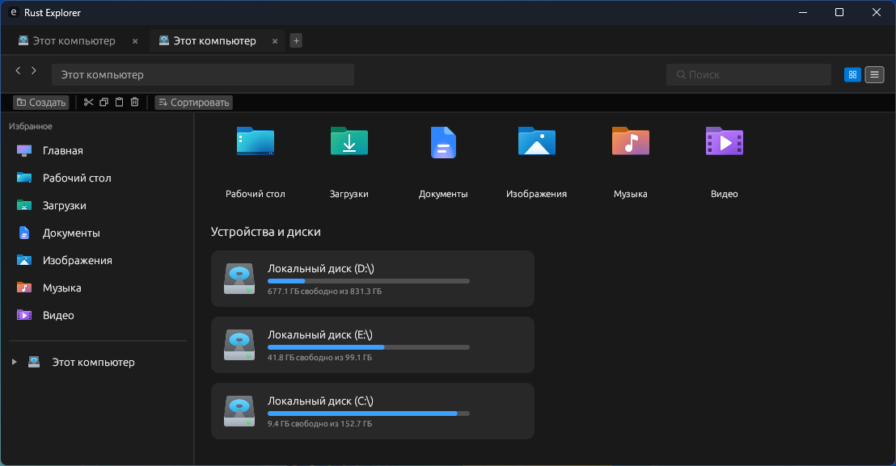
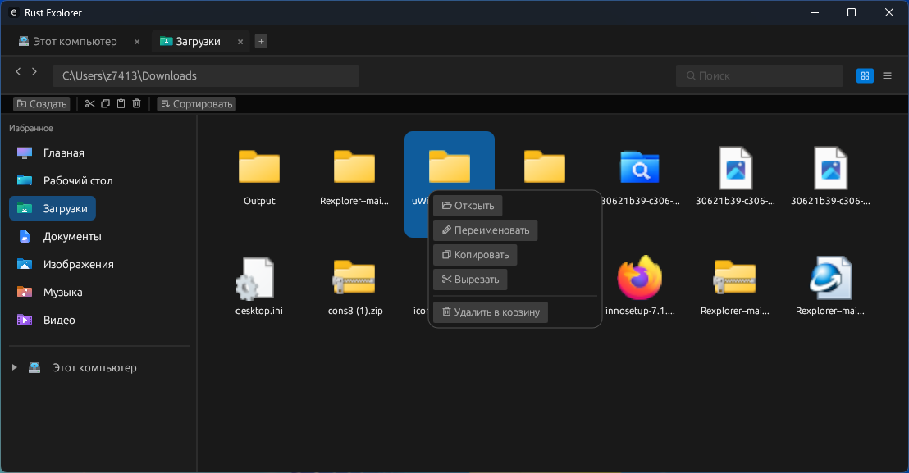
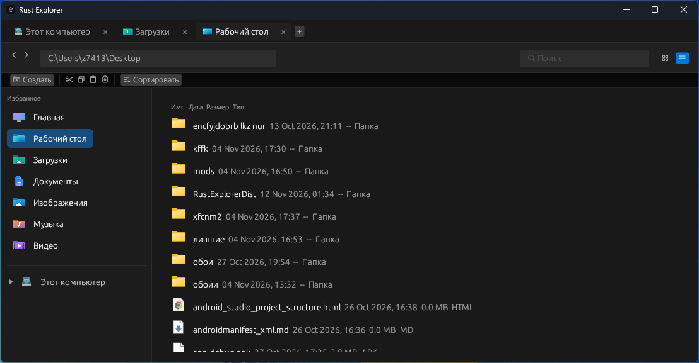

russian

# Rexplorer

Экспериментальный проводник для Windows, написанный на Rust!

## Особенности
*   **Древовидное меню «Этот компьютер»**: интерактивная стрелочка для раскрытия списка дисков.
*   **Страница «Этот компьютер»**: отображение дисков в виде красивых карточек.
*   **Вкладки**: поддержка нескольких открытых папок одновременно.
*   **Работа с файлами**: контекстное меню, копирование, перемещение и удаление в корзину.
*   **Боковая панель**: быстрый доступ к системным папкам (Главная, Загрузки, Документы и т.д.)
*   И многое другое..

## Скриншоты

| Главное окно | Меню "Этот компьютер" |
| :---: | :---: |
|  |  |

| Навигация | Работа с файлами |
| :---: | :---: |
|  |  |

## Установка (Ранняя Бета)
1. Перейдите в раздел [Releases](https://github.com/z7413130-a11y/Rexplorer-/releases).
2. Скачайте последний файл `Rexplorer_Setup_v1.0.exe`.
3. пользуйтесь!

english

# Rexplorer

An experimental file explorer for Windows, written in Rust!

## Features
*   **"This PC" Tree Menu**: An interactive arrow to expand the list of drives.
*   **"This PC" Page**: Displays drives as beautiful cards.
*   **Tabs**: Support for multiple open folders at the same time.
*   **File Operations**: Context menu, copying, moving, and deleting to the Recycle Bin.
*   **Sidebar**: Quick access to system folders (Home, Downloads, Documents, etc.)
*   And much more..

## Screenshots

| Main Window | "This PC" Menu |
| :---: | :---: |
|  |  |

| Navigation | File Operations |
| :---: | :---: |
|  |  |

## Installation (Early Beta)
1. Go to the [Releases](https://github.com/z7413130-a11y/Rexplorer-/releases) section.
2. Download the latest `Rexplorer_Setup_v1.0.exe` file.
3. Enjoy!
